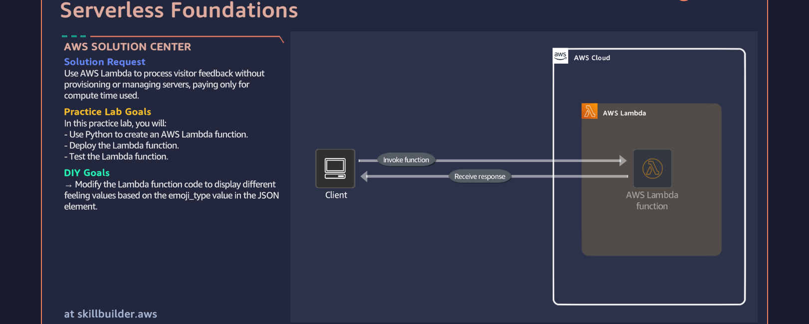
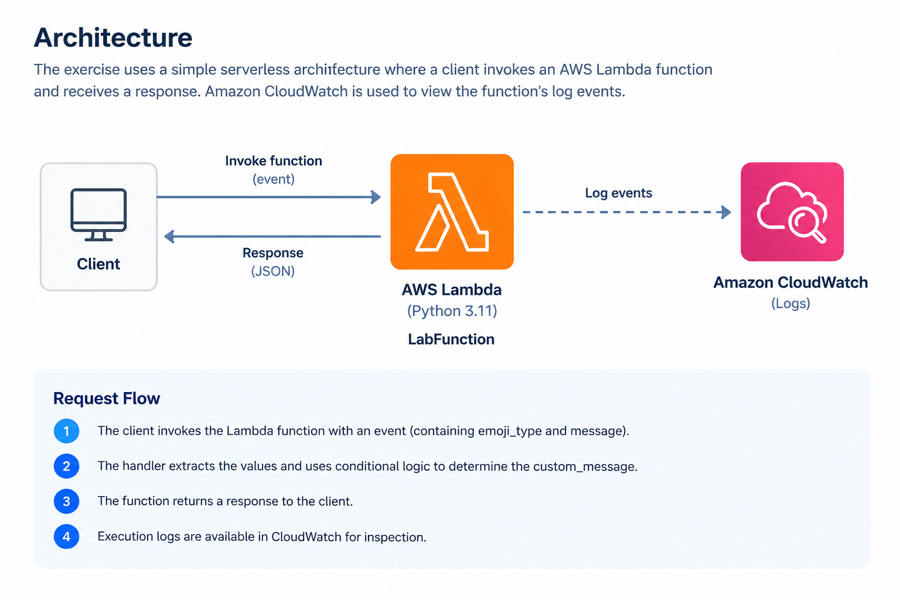
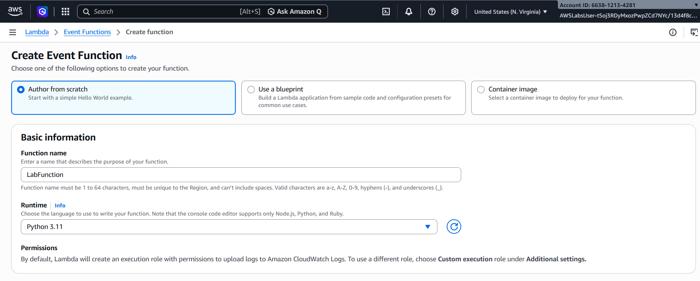
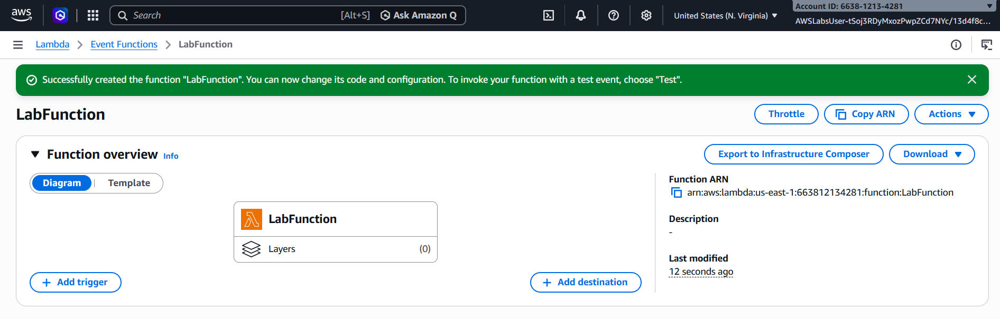
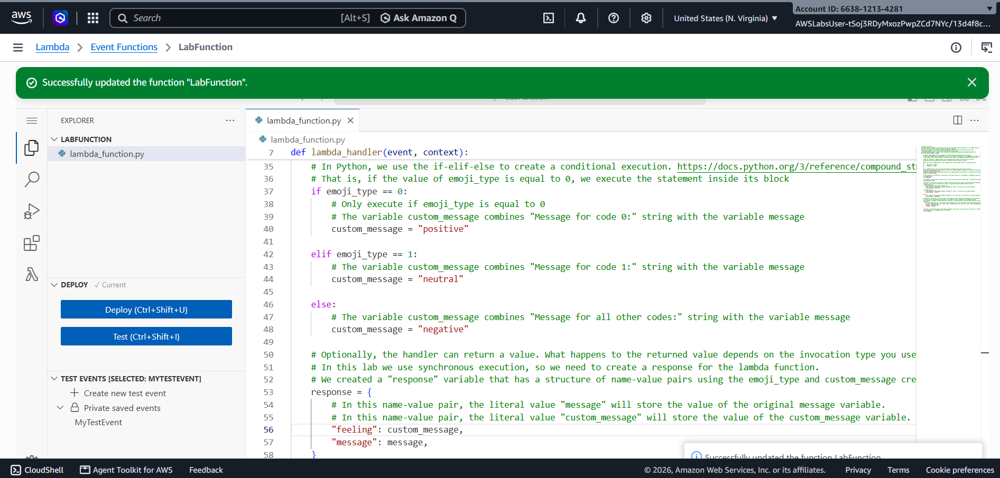
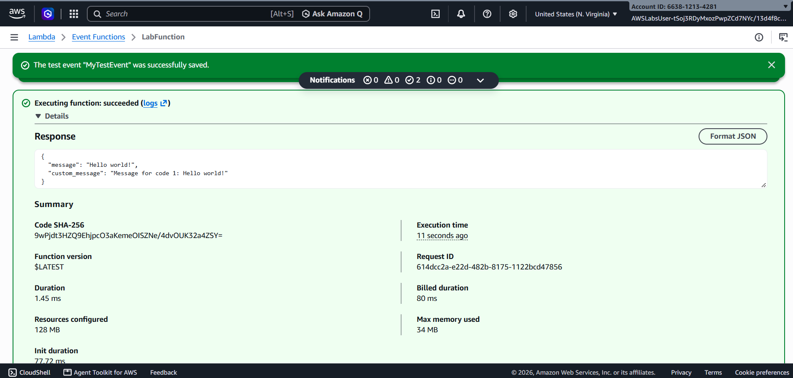
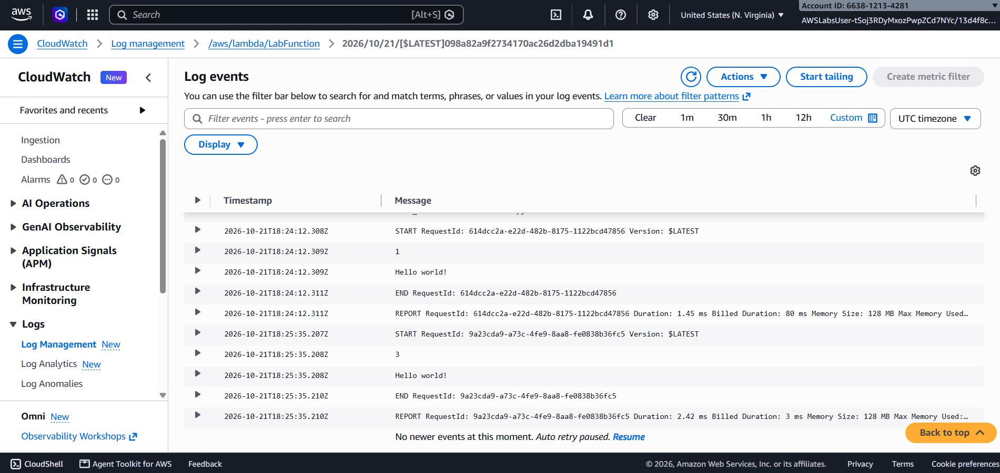

# Serverless Foundations — AWS Lambda with Python

A hands-on AWS Skill Builder SimuLearn exercise exploring serverless compute, Python Lambda handlers, event-driven input processing, and conditional logic.

## Overview

The objective was to process visitor feedback using AWS Lambda without provisioning or managing servers.

I created a Lambda function using Python 3.11, deployed and tested it, then modified its logic to map an incoming `emoji_type` value to a feeling label.

## The Scenario

The exercise provided a visitor-feedback scenario in which a client sends an event to a Lambda function and receives a response.

The input event contains two fields:

- `emoji_type`: A value used to determine the response.
- `message`: The visitor's message.

The function processes these values and returns a response containing the original message and a computed `custom_message`.



## Architecture

The following diagram is a documentation diagram based on the exercise scenario.



### Request flow

1. The client invokes the Lambda function with an event.
2. The handler extracts `emoji_type` and `message`.
3. Conditional logic determines the value of `custom_message`.
4. The function returns a response to the caller.
5. Execution logs can be inspected in Amazon CloudWatch.

The exercise uses synchronous invocation. CloudWatch is used for log inspection, not as part of the request-response path.

## AWS Services and Technologies

| Service / Technology | Purpose |
|---|---|
| AWS Lambda | Executes the Python handler |
| Amazon CloudWatch | Allows inspection of function log events |
| Python 3.11 | Runtime selected for the Lambda function |
| JSON event | Supplies input values to the handler |

## Implementation

### 1. Create the function

I created a Lambda function named `LabFunction` using the **Author from scratch** option and selected Python 3.11.



The function was created successfully.



### 2. Read the incoming event

The starter code extracts the input values from the event:

```python
emoji_type = event["emoji_type"]
message = event["message"]
```

It prints both values, which can be inspected in the execution output and CloudWatch logs.

### 3. Understand the original logic

The original implementation uses `if`, `elif`, and `else` to build a message based on the incoming `emoji_type`.

| `emoji_type` | Original `custom_message` |
|---|---|
| `0` | `Message for code 0: ` followed by the input message |
| `1` | `Message for code 1: ` followed by the input message |
| Any other value | `Message for all other codes: ` followed by the input message |

The handler returns a dictionary with two keys: `message` and `custom_message`.

### 4. Modify the function — DIY task

The DIY task was to change the conditional logic so that the function returns a feeling label instead of prefixing the original message.

The updated mapping is:

| `emoji_type` | `custom_message` |
|---|---|
| `0` | `positive` |
| `1` | `neutral` |
| Any other value | `negative` |

The original `message` remains in the returned response; only the logic used to calculate `custom_message` changes.



## Testing and Validation

I created a test event and invoked the Lambda function to inspect its output.



After the DIY change, I tested all three cases:

- `emoji_type = 0` returned `positive`.
- `emoji_type = 1` returned `neutral`.
- Another value, such as `2`, returned `negative`.

**Result: All three test cases passed.**

## Logging and Observability

I also inspected the function's CloudWatch log events.



The handler prints the extracted `emoji_type` and `message` values, providing information that can be inspected during execution.

## Key Learnings

- **Lambda handlers:** A handler receives event data when the function is invoked.
- **Event processing:** Input fields can control how a function processes a request.
- **Conditional logic:** `if`, `elif`, and `else` allow different outputs for different input values.
- **Synchronous invocation:** The caller can receive the value returned by the handler.
- **Logging:** CloudWatch provides access to Lambda execution logs.

## What I Would Explore Next

A useful next step would be to examine how the function behaves when expected event fields are missing or have unexpected types. The exercise's supplied handler directly accesses `event["emoji_type"]` and `event["message"]`, so those cases would be worth investigating separately.

This is a potential follow-up investigation, not behavior tested as part of this exercise.

## Repository Evidence

The `screenshots/` directory contains the original exercise overview, function creation and update evidence, test results, CloudWatch logs, the DIY code change, and a cleaned-up architecture diagram.

## Scope and Disclaimer

This repository documents a learning exercise completed through AWS Skill Builder SimuLearn. The work demonstrates the concepts practiced in the exercise and is not presented as an independently designed production system.

## Source

AWS Skill Builder — SimuLearn: Serverless Foundations