# Image and Video Analysis — AWS Lambda and Amazon Rekognition

A hands-on AWS Skill Builder SimuLearn exercise exploring image analysis, event-driven processing, Amazon S3 notifications, AWS Lambda, and Amazon Rekognition label detection.

## Overview

The objective was to identify objects in images using Amazon Rekognition and process the results through a serverless workflow.

I configured an S3 input and output location, created a Lambda function to invoke Rekognition, and configured S3 event notifications to trigger processing when images were uploaded. The DIY task extended the implementation to detect a spaceship.

## The Scenario

The Space Administration Department wants to identify UFOs flying over a city.

The exercise uses sample images, including an airplane and a horse, to demonstrate image-label detection. The DIY task introduces a spaceship image to extend the solution.

The workflow processes an uploaded image and stores the resulting analysis as a JSON file in Amazon S3.

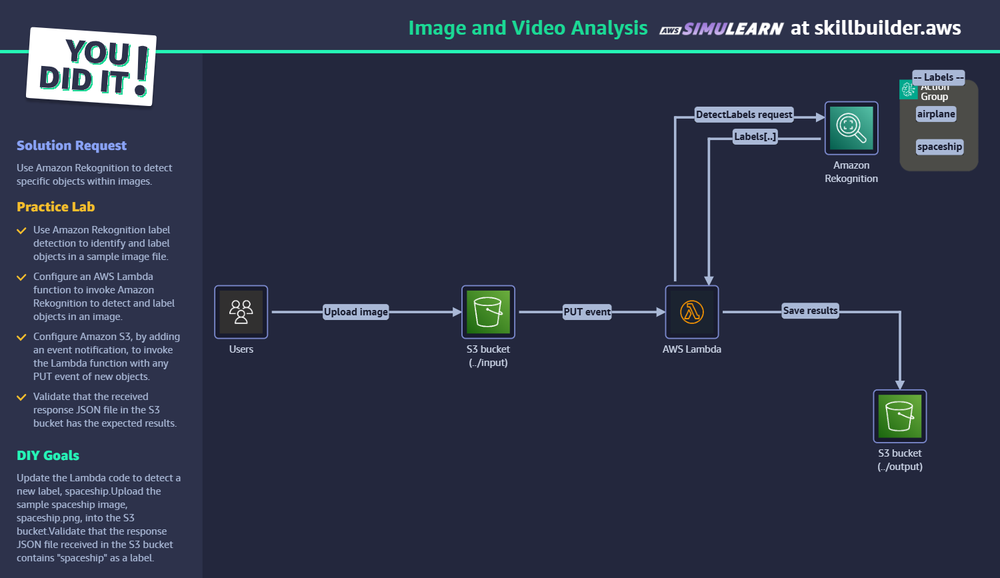

## Architecture

The following diagram is a documentation diagram based on the exercise scenario.

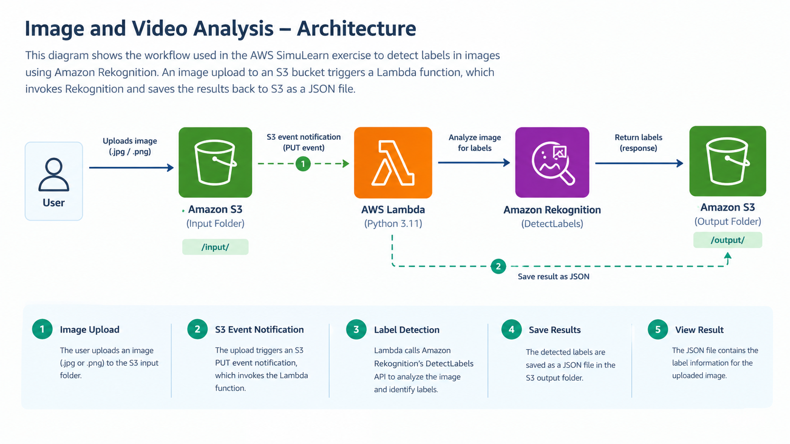

### Request flow

1. A user uploads a JPG or PNG image to the S3 input location.
2. An S3 PUT event notification invokes the Lambda function.
3. Lambda reads the bucket name and object key from the event.
4. Lambda calls Amazon Rekognition's `DetectLabels` API.
5. The function checks the detected labels against a configured label.
6. Lambda writes the JSON response to the S3 output location.

The workflow connects object storage, serverless compute, and managed image analysis.

## AWS Services and Technologies

| Service / Technology | Purpose |
|---|---|
| Amazon S3 | Stores input images and generated JSON responses |
| AWS Lambda | Processes S3 events and coordinates image analysis |
| Amazon Rekognition | Detects labels in images using the `DetectLabels` API |
| Python | Implements the Lambda handler |
| Boto3 | Provides the Python SDK clients used to interact with AWS services |
| JSON | Stores the image-analysis response |

## Implementation

### 1. Configure S3 storage

The exercise uses an S3 bucket with separate input and output locations.

The input location receives images, while the output location stores the JSON response generated by the Lambda function.

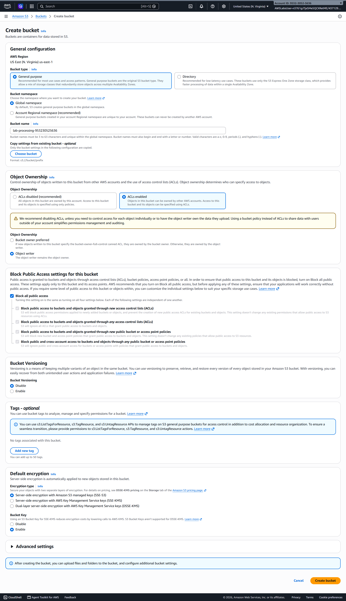

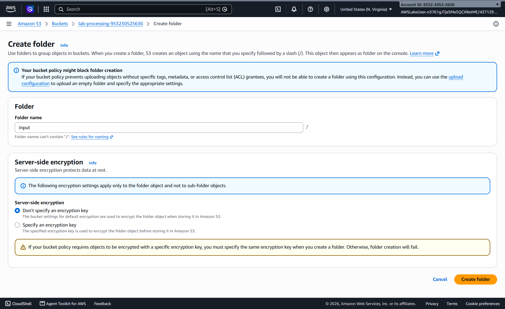


### 2. Create and configure the Lambda function

I created a Lambda function to process the S3 event and coordinate the image-analysis workflow.

The supplied Lambda source code is contained in `lab-files/lambda.zip`, which includes `index.py`.

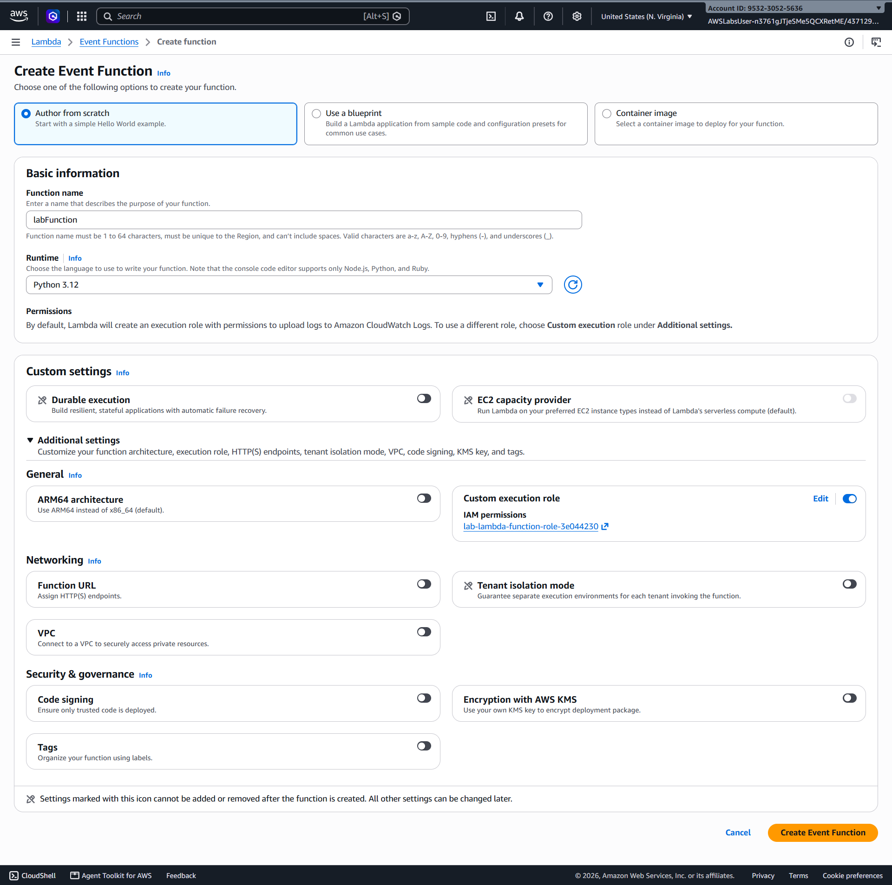

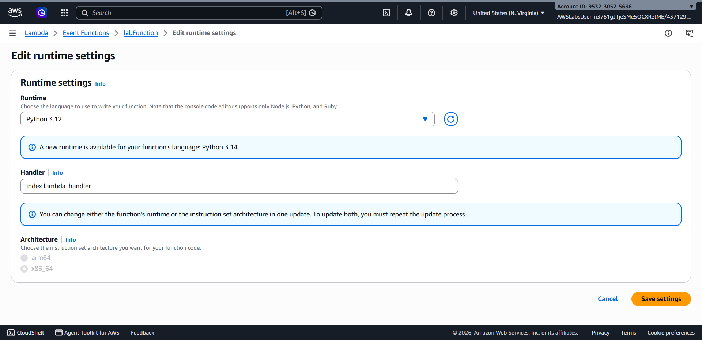

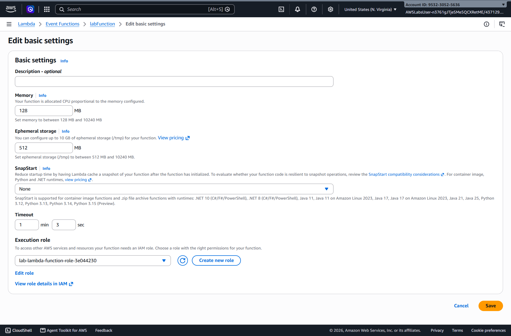

### 3. Configure S3 event notifications

S3 event notifications connect image uploads to Lambda execution.

The exercise includes event notification configuration for JPG and PNG image uploads.

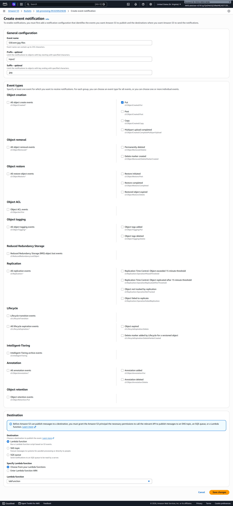

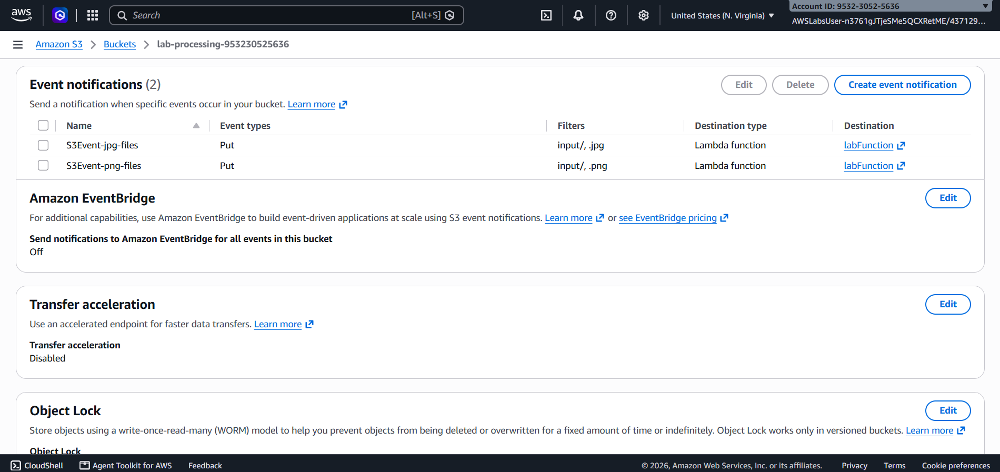

### 4. Process images with Amazon Rekognition

The supplied Python implementation extracts the bucket name and object key from the incoming S3 event.

It then calls the Rekognition `DetectLabels` API with a minimum confidence threshold of `70`.

The relevant API call is:

```python
response_rekognition = rekognition_client.detect_labels(
    Image={
        "S3Object": {
            "Bucket": bucket,
            "Name": image
        }
    },
    MinConfidence=70
)
```

The function converts the detected label names to lowercase and checks whether the configured label appears in the results.

### 5. Generate the JSON response

The function prepares a response containing a status and a list of detected labels.

The supplied source initializes the response as follows:

```python
response = {
    "Status": "Not Found",
    "body": []
}
```

When Rekognition returns labels, the function appends the label objects to `body` and updates `Status` according to whether the configured label was found.

The response is serialized as JSON and written to:

```text
output/rekognition_response.json
```

The output key is fixed in the supplied implementation.

### 6. Test the sample images

The exercise includes an airplane image and a horse image to demonstrate the workflow.

**Airplane**

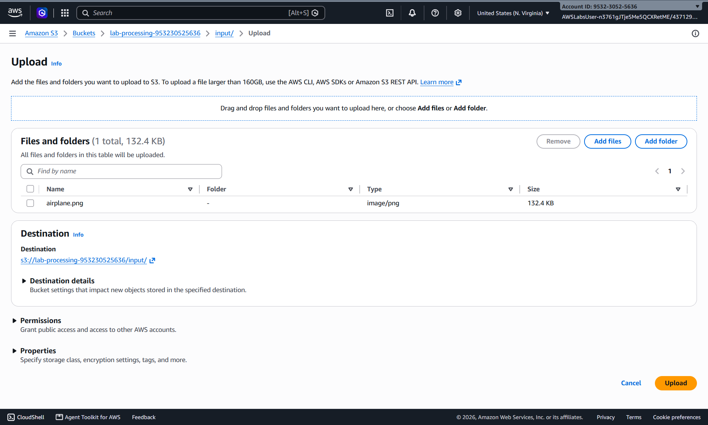

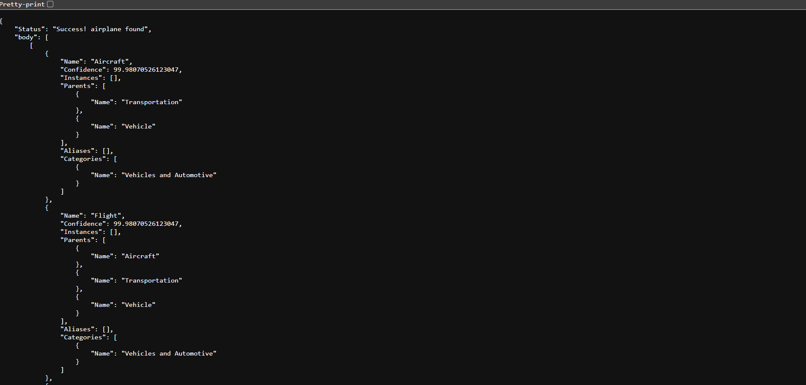

**Horse**

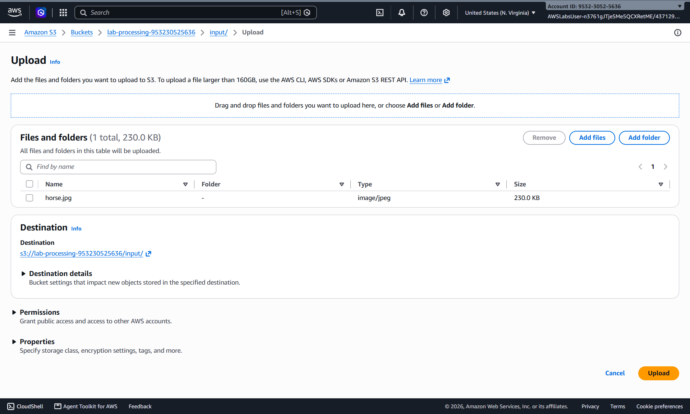

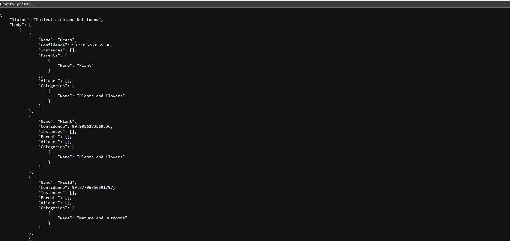

### 7. Modify the implementation — DIY task

The DIY task was to extend the workflow to detect a spaceship.

The repository contains screenshots documenting the code modification, spaceship upload, and resulting response.

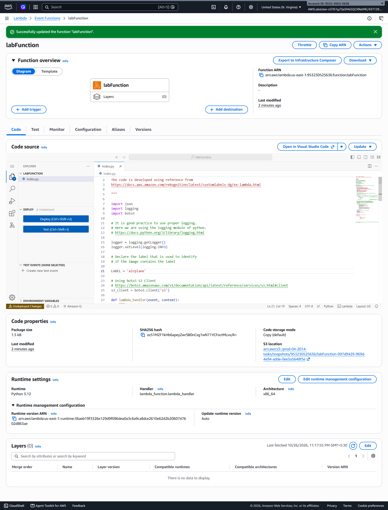

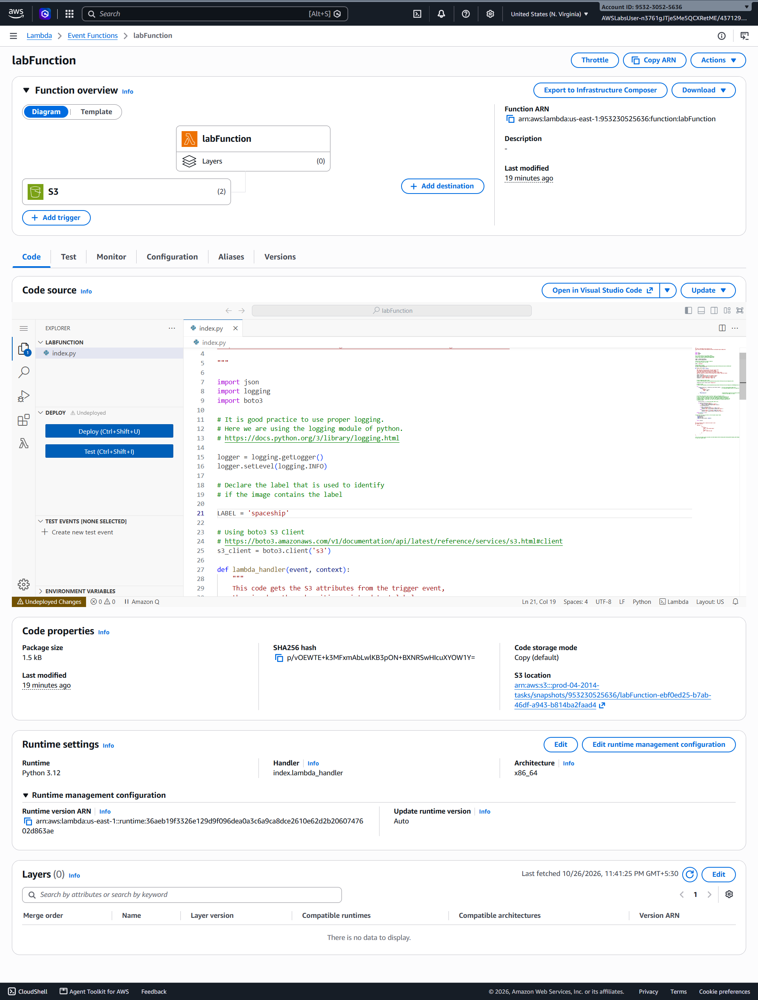

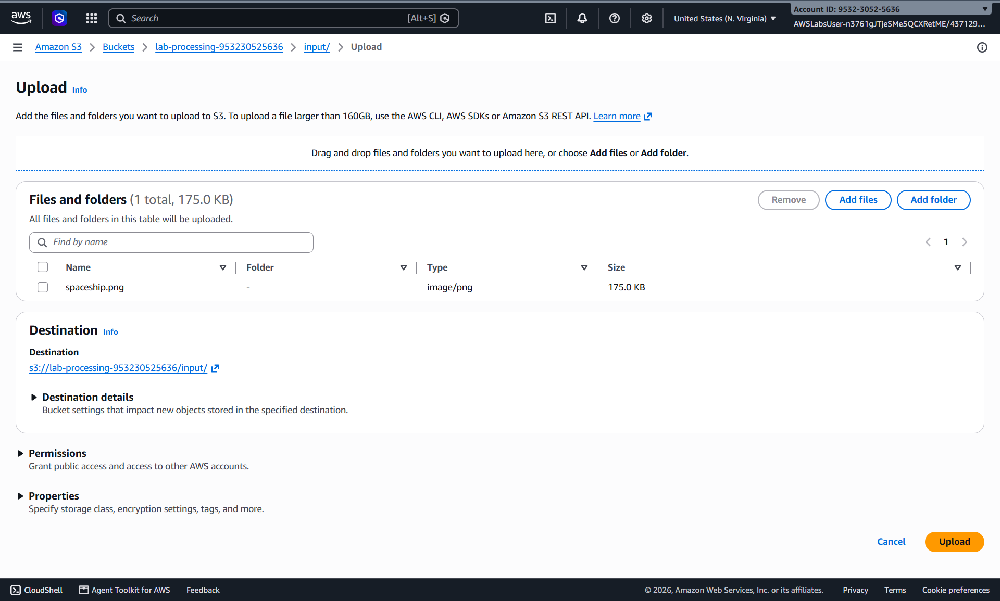

### 8. Verify the output

The final validation step involves inspecting the JSON response stored in the S3 output location.

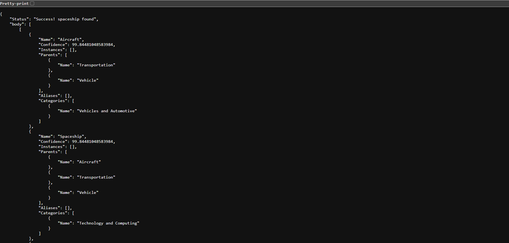

The DIY objective is to verify that the response contains `spaceship` as a detected label.

## Testing and Validation

The exercise includes evidence of processing the airplane and horse sample images, modifying the implementation for the spaceship task, and inspecting the resulting JSON response.

The exact detected labels, confidence values, and response status should be confirmed from the saved JSON files before being documented individually.

## Key Learnings

- **Event-driven processing:** S3 event notifications can trigger Lambda when objects are uploaded.
- **Serverless orchestration:** Lambda can coordinate calls to other AWS services without requiring manually managed servers.
- **Managed image analysis:** Amazon Rekognition provides label detection through an API.
- **Confidence thresholds:** The supplied implementation sets `MinConfidence` to `70`.
- **JSON output:** Analysis results can be serialized and stored in S3 for inspection.
- **Error handling:** Exceptions and unsuccessful label matches should be distinguishable when designing a more robust workflow.

## What I Would Explore Next

A useful next step would be to investigate how the implementation behaves when Rekognition fails, when an image contains no matching label, or when multiple images are processed concurrently.

The supplied source writes every response to the same output key, `output/rekognition_response.json`. A possible improvement would be to generate a separate output key for each input image to prevent results from overwriting one another.

These are potential follow-up investigations, not claims that these scenarios were tested during the exercise.

## Repository Evidence

The repository contains:

- `architecture.png` — cleaned-up architecture diagram.
- `lab-files/` — sample images, the Lambda source ZIP, and JSON response files.
- `screenshots/` — evidence of S3 configuration, Lambda creation and configuration, event notifications, image uploads, code modification, and output validation.

## Scope and Disclaimer

This repository documents a learning exercise completed through AWS Skill Builder SimuLearn. The work demonstrates the concepts practiced in the exercise and is not presented as an independently designed production system.

## Source

AWS Skill Builder — SimuLearn: Image and Video Analysis